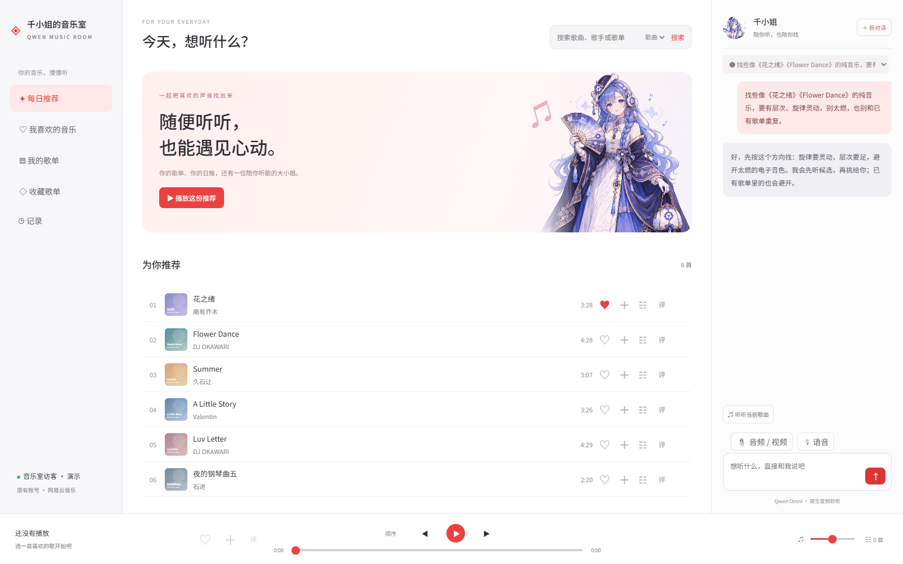
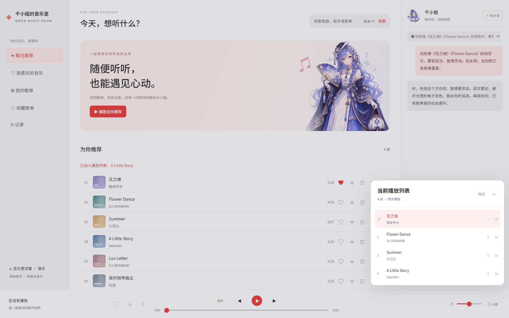
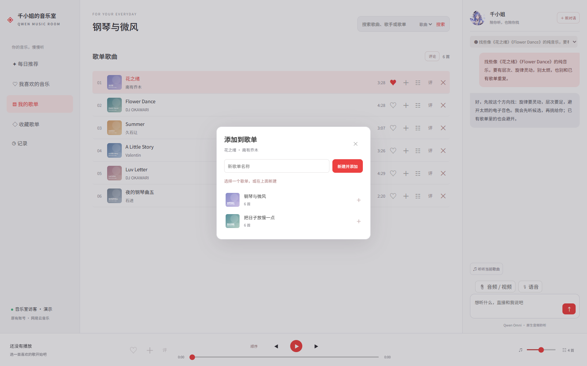
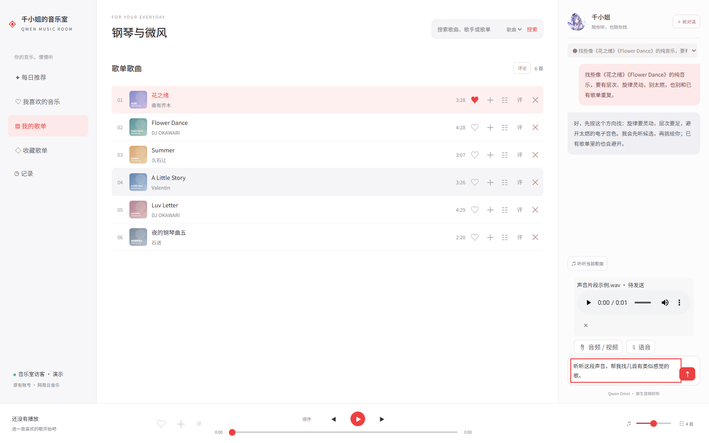

# 千小姐的音乐室

**把“想听什么”告诉她，让她自己找歌、听歌，再陪你把歌单排好。**

Qwen Omni 原生音频理解 × 网易云音乐 × 连续对话 Agent。独立运行，不依赖 Pi、Claude Code 或 DSH。



> 本文截图由真实界面配合独立演示数据生成；封面、对话和歌单仅用于界面说明，不代表歌曲播放授权或真实模型试听结论。不包含作者账号、聊天或登录信息。

[快速安装](#安装) · [交给你的-ai](#交给-ai-的一句话) · [播放与歌单](#播放队列与歌单) · [音视频输入](#时间记录和音视频消息) · [已知边界](#已知边界)

一个能直接分析歌曲音频、自己搜索和挑歌，并操作网易云歌单的音乐 Agent。支持连续对话、中途补充要求、独立新对话、播放队列、顺序/随机/单曲循环、红心、加入已有歌单、移除歌单内歌曲和查看评论。

支持 `web_search` 网络查询：搜索曲目背景、作曲编曲、创作者与其他公开资料，在同一对话内显示查询过程和可点击的来源链接。沿用自己的百炼 Key，通过 Qwen Omni 的 Responses 内置搜索调用，无需额外搜索服务 Key。搜索按百炼模型与工具价格另行计费；摘要可能出错，不能代替实际试听。详见[官方联网搜索说明](https://help.aliyun.com/zh/model-studio/web-search)。

这是 **Windows 源码自部署版**。使用者配置自己的全部凭证，费用与接口权限归自己的账号。你可以把这个仓库交给自己的 AI，让它按照 `AGENTS.md` 安装。

## 交给 AI 的一句话

> 阅读这个仓库的 README.md 和 AGENTS.md，在独立目录安装并配置千小姐的音乐室。使用我自己的百炼和网易云应用凭证，需要输入密钥或扫码时再叫我；不要读取或修改我其他项目的账号，不要替我找歌、建单或改红心来测试安装。

## 运行环境

- Windows，Node.js 24 或更新版本，PowerShell 7（`pwsh` 命令）。
- 网易云开发者应用：App ID、RSA Private Key，以及对应 API 权限。
- 百炼：支持 `qwen3.8-omni-flash` 的 API Key 和同一地域业务空间的服务地址。
- 自己的网易云账号，使用手机扫码授权。

## 安装

在仓库根目录运行：

```powershell
npm ci
Copy-Item .env.example .env
New-Item -ItemType Directory -Force private
```

编辑 `.env`，填写：

| 配置 | 内容 |
| --- | --- |
| `DASHSCOPE_API_KEY` | 自己的百炼 Key |
| `DASHSCOPE_BASE_URL` | 自己业务空间的 OpenAI 兼容地址，末尾为 `/compatible-mode/v1` |
| `NCM_APP_ID` | 自己的网易云开发者应用 App ID |
| `NCM_PRIVATE_KEY_PATH` | 自己 RSA 私钥 PEM 文件的路径，默认 `./private/netease-private.pem` |

将网易云 Private Key 保存成标准 PEM 文件。若控制台提供的是裸 Base64，需加上对应的 PEM 头尾并分行；不要把 AppSecret 当 Private Key。本项目不需要把 AppSecret 填进 `.env`。

服务地址与 Key 的地域必须匹配；请复制自己控制台的地址。上传服务默认使用相同域名；若控制台另有上传入口，再配置 `DASHSCOPE_UPLOAD_BASE_URL`。切勿照抄其他人的 Workspace ID。

然后执行：

```powershell
npm run configure
npm run login
npm run doctor
npm start
```

手机扫描登录命令显示的二维码并确认授权。启动后，在浏览器打开 `http://127.0.0.1:58238`。端口冲突可修改 `.env` 的 `MUSIC_PORT`。

关闭终端会停止服务；重新运行 `npm start` 即可恢复。修改 `.env` 后也需要重新启动。首次配置不需要迁移或复制任何作者的 `private`、`state` 或 `cache`。

## 怎么用

例如：

> 找些像《花之绪》《花雨繁星》的纯音乐，要有足够的信息量，不要电音和燃曲，避开我的歌单里已经有的。

她会读取需要的歌单，搜索候选，将实际音频交给模型分析，再记录取舍。需要歌单时明确说“加入这个歌单”或“建立新歌单”。过程中可继续发送补充要求；当前操作结束后会读取新消息。

播放控制也直接说即可，例如“跳到 1 分 30 秒”“音量调到四分之一”“把队列第三首移到下一首”“切成随机播放”。她能查询实际播放状态，控制切歌、暂停/继续、播放时间、音量/静音、模式，以及队列的插入、移动、完整排序、移除、替换和清空。队列位置从 1 开始，切指定歌曲会保留原队列；播放整个歌单则替换队列。操作等待播放器执行回执，窗口关闭或浏览器拒绝播放时会返回失败。

陪听和循环找歌无需按钮，也无需新任务，直接告诉她：

- “陪我听歌，每首给一句简单评价。”开启逐首原生音频陪听。
- “一直按这个口味找歌，接到下一首，每首也评价一下。”开启陪听 DJ。
- “一直帮我接下一首，不用评价。”开启只续歌的循环。
- “停止陪听和自动找歌。”关闭循环；界面里的“停止”也会关闭当前对话的自动循环。

播放器每次开始新歌会在原来的主对话继续处理，续歌提前准备一首，不在子会话分析，也不会一次无限填充队列。队列为空时续歌模式会找第一首并尝试播放。当前播放器窗口需要保持打开；后台服务重启后需重新要求开启陪听模式。自动陪听会分析音频并消耗用户自己的模型/搜索额度。

这里的“一起听”是你与千小姐陪听；尚未接网易云好友同步一起听房间。衔接使用当前播放器的逐曲播放，不保证无缝或交叉淡化混音。

## 播放队列与歌单

搜索、播放、红心、加入已有歌单、移除歌单歌曲都能在界面完成，也可以直接告诉千小姐。顺序播放、随机播放、单曲循环与队列编排操作的是当前播放列表；云歌单写入会另行读回核对。



选择已有歌单，或新建后加入；不是每次都强制创建新歌单。



## 时间、记录和音视频消息

直接说“现在几点”“等30秒后继续”“两分钟后提醒我”。`sleep` 会暂停本轮 Agent 并由后台定时器唤醒原对话，服务和输入框保持可用；用户新消息会打断 sleep。普通提醒可以用自然语言取消。

例如“这首到1分20秒时把音量调到70%”，会用 `schedule_player_action` 提前把动作交给播放器；暂停时歌曲进度不推进，切歌或重播会取消旧歌曲上的动作。也支持从现在延迟执行、按带时区的绝对时间执行，以及暂停/开始/切歌/切模式。不是等模型到点再思考；它依赖浏览器的媒体事件和计时，不能保证采样级精度。

侧栏“记录”可查看本机播放记录、网易云最近记录、千小姐的试听笔记和当前对话的定时操作。实际播放片段、模型试听和完整听过分别处理。网易云接口可能返回空列表或权限错误；本机记录从本功能启用后开始积累并保存在 `state/play-history.json`，不会自动同步回网易云。

聊天框支持选择音频/视频文件，也可粘贴、拖入文件；“语音”按钮使用浏览器麦克风录音，停止后转为 WAV，确认发送到当前对话。附件有发送前预览、移除和发送后回放。录音与文件原生交给 Omni，不使用 ASR 代替；模型若需再次核对附件，可调用 `read_user_media`。本地原文件位于 `cache/user-media`，发送时上传到自己的百炼临时存储，以链接传入，不把大文件 Base64 塞进请求。应用没有额外设置文件大小或时长上限，但平台、磁盘和浏览器的实际限制仍适用。

定时操作需要保持播放器/后台运行。后台服务重启会取消未完成的 sleep 与提醒；刷新或关闭播放器会丢弃该窗口的歌曲定时动作。需要长期跨重启的计划任务时，应另行实现持久调度。



### 听歌识曲

可以发送音频或视频问“这是什么歌”。目前是 Omni 原生听音频，提取听清的短歌词、语言等线索，再结合网页与网易云搜索寻找和试听候选；没有音频指纹匹配证据时只报告推测，不保证识别成功。

专业识曲 API 尚未接入：可选 [AudD](https://docs.audd.io/) 的曲目识别，或 [ACRCloud](https://docs.acrcloud.com/reference/identification-api/identification-api) 的音频/指纹识别；[哼唱识别](https://www.acrcloud.com/humming-recognition/)是单独能力，需核实项目权限和曲库覆盖。此类服务需要另配自己的凭证。腾讯相关接口的[官方说明](https://multimedia.tencent.com/zh/docs/smart-music/api/7-music-recognition/)标注只检索已入库的热门曲库，不能当成完整音乐曲库。

## 已知边界

- 开放 API 的可用音源和官方客户端不完全一致；VIP 或客户端可播放不代表开放接口提供音源。官方 CLI 的“已发送到播放服务”也不等于实际播放成功。实测无音源歌曲会在后台被跳过，改用 CLI 不能保证解决灰歌。
- 部分接口可能需要额外申请权限。例如收藏其他人的歌单，未授权时会显示接口错误。
- 支持移除歌单内歌曲；未实现删除整个歌单、一起听和歌词面板。
- 模型直接处理音频、输出文字；界面没有 Live2D 或模型语音回复。
- 模型可能听错或选不中。接收完整音频不保证每个听感判断正确；播放器进度也不是模型聆听进度。
- 目前支持 Windows。没有用新的外部账号完成首次扫码到播放的全链路验收，不宣称已在所有机器可用。

## 数据和登录

`.env` 和私钥在本地保存；扫码令牌使用当前 Windows 用户的 DPAPI 加密，不能直接搬给另一位用户使用。

- `private/`：自己的私钥、加密授权令牌、上传链接缓存。
- `state/`：自己的对话、音乐偏好、CLI 独立登录配置。
- `cache/`：本地音频缓存和测试临时数据。

对话及需要分析的音频会发送到你配置的百炼服务。上述本地数据目录和 `.env` 已被 Git 忽略。

授权过期时运行 `npm run login` 重新扫码。CLI 刷新授权后，若网页仍提示登录失效，运行 `npm run sync-session` 并重启服务。当前令牌同步适配官方 CLI 0.1.7 的本地加密缓存，升级 CLI 时需要重新验证。

## 开发验证

```powershell
npm test
```

测试使用模拟模型和 API，不应操作真实网易云歌单。`npm run doctor` 仅做本地检查，不验证模型服务、余额、接口权限或登录是否已到期。

当前锁定的官方 CLI 0.1.7 依赖树存在 npm audit 已知告警（包括其 build 链中的旧依赖）。本项目没有为消除告警而强制替换未经验证的跨版本依赖；升级时需要核对 CLI 配置、扫码和令牌同步兼容性。

## 官方资料

- [网易云开发者入驻](https://developer.music.163.com/st/developer/apply/account?type=INDIVIDUAL)
- [网易云官方 CLI / Agent 配置说明](https://github.com/NetEase/skills)
- [百炼 Qwen-Omni 文档](https://help.aliyun.com/zh/model-studio/qwen-omni)

## 分发与许可

这是使用者自行配置全部凭证的 Windows 源码测试版。仓库不包含作者的 Key、RSA 私钥、账号令牌、对话、偏好或音乐缓存。不要把正在使用的整个工作目录直接打包分发。

本项目暂未指定开源许可证，人物素材未附额外授权声明。第三方依赖保留各自许可证。本项目与阿里云、网易云及其产品不存在官方隶属关系。

文档截图可通过 `docs/capture-readme.py` 在独立演示环境中重新生成；该脚本需要开发者另装 Python、Playwright 与 Edge，不是日常运行依赖，也不会调用真实账号或模型。
